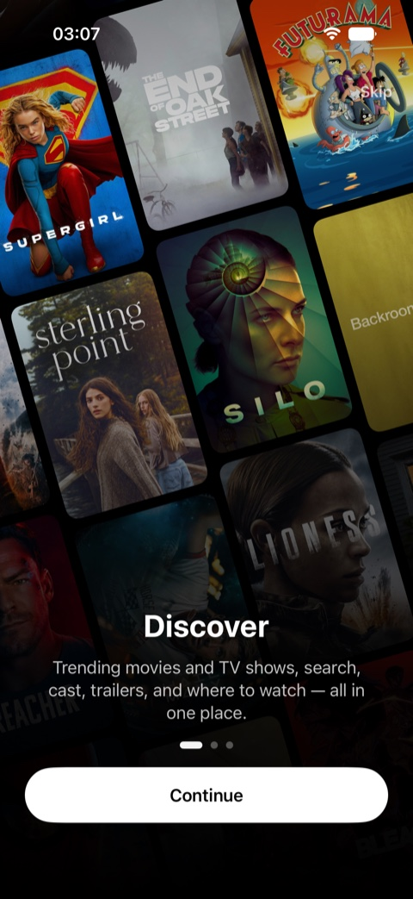
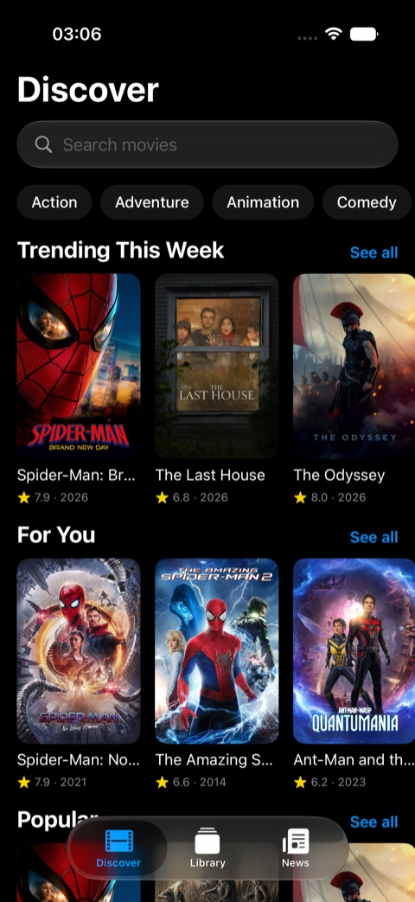
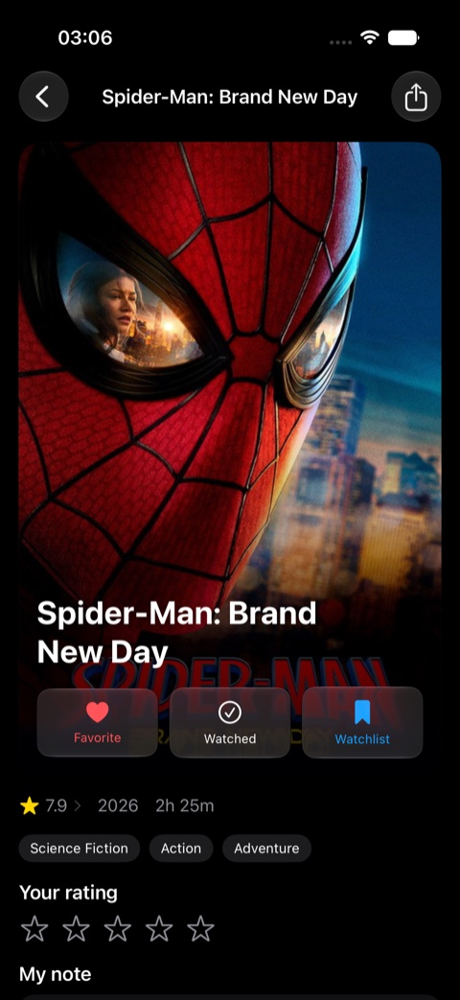
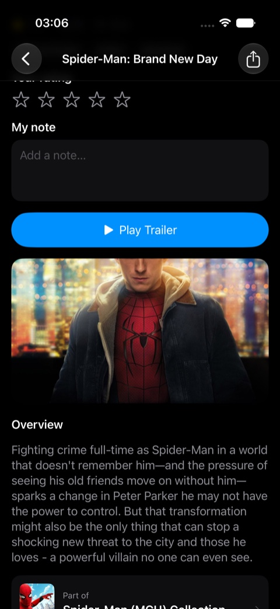
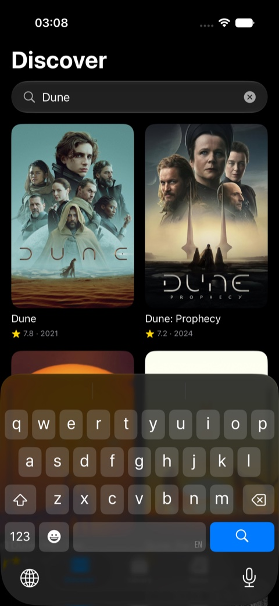
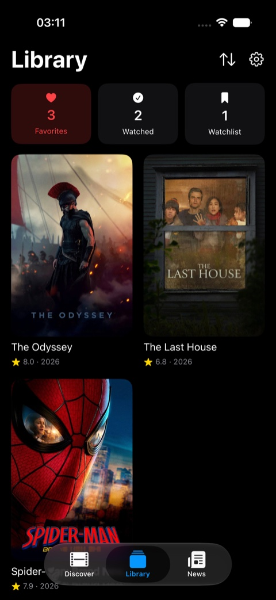
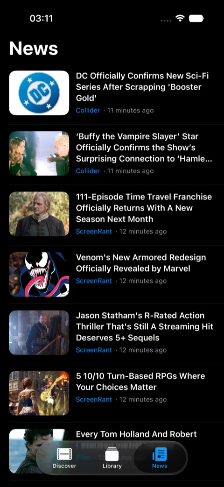

# Cinemate

A movie and TV tracker for iPhone and iPad, built in Swift and SwiftUI on top of the TMDB API.

Discover what is trending, search across films and shows, open a detail screen with cast, trailers and streaming providers, and keep your own library of what you want to watch, what you have watched and what you loved. Everything you track is stored on device with SwiftData and synced across your devices through iCloud.

**On the App Store:** [apps.apple.com/us/app/cinemate-movie-tracker](https://apps.apple.com/us/app/cinemate-movie-tracker/id6797075352)

**Free app, no ads, no in-app purchases.**

## Screenshots

| Onboarding | Discover | Detail |
|---|---|---|
|  |  |  |

| Rating, notes & collections | Search | Library | News |
|---|---|---|---|
|  |  |  |  |

## Features

- **Discover**: trending, popular and upcoming carousels that mix films and TV shows, a "For You" row seeded by what you already like, and browse-by-genre chips leading to an infinite-scroll grid.
- **Search**: one search field across films, shows and people.
- **Detail screens**: runtime, genres, rating, overview, cast, trailer link, and "where to watch" providers. Tap an actor for their biography and filmography; tap a franchise to see the whole collection in release order.
- **Tracker**: mark anything as Watchlist, Watched or Favorite, give it a star rating, and attach a private note.
- **Library**: a stats strip plus filtering and sorting across everything you track.
- **News**: a movie-news feed with thumbnails, opening in Safari.
- **Widgets**: two home-screen widgets (Trending and For You) in small and medium sizes, with an interactive button that flips to the next title on demand.
- **Reminders**: add an unreleased film to your watchlist and Cinemate schedules a local notification for release day.
- **iCloud sync**: your library follows you across devices, with no account to create.
- **iPad**: adaptive layouts throughout, including a two-column detail screen and a sidebar-adaptable tab bar.

## Tech

| Area | What is used |
|---|---|
| Language & UI | Swift, SwiftUI, Swift Concurrency (async/await) |
| Architecture | MVVM, feature-organised views, view models and services |
| Persistence | SwiftData, mirrored to CloudKit |
| Networking | URLSession with `Codable` models against the TMDB REST API |
| Widgets | WidgetKit, App Intents, shared storage through an App Group |
| System | UserNotifications, Firebase Analytics |
| Testing | Swift Testing for units, XCUITest for flows |
| CI | Xcode Cloud |

## Project layout

```
Cinemate/
  App/           entry point and root navigation
  Models/        TMDB payloads and SwiftData records
  Networking/    API client and endpoints
  Services/      notifications, analytics, widget bridge
  Views/         feature screens and reusable components
  Config/        API configuration
CinemateWidget/  widget extension and its App Intent
CinemateTests/   Swift Testing unit tests
CinemateTestsUI/ XCUITest flows
```

## Building

Requires Xcode 26 or newer and an iOS 18+ device or simulator.

1. Get a free API key from [TMDB](https://www.themoviedb.org/settings/api).
2. Create `Cinemate/Config/Secrets.swift`:

   ```swift
   enum Secrets {
       static let tmdbAPIKey = "YOUR_KEY"
   }
   ```

3. Open `Cinemate.xcodeproj` and run the `Cinemate` scheme.

Firebase Analytics is optional: the app runs without `GoogleService-Info.plist`.

## Attribution

This product uses the TMDB API but is not endorsed or certified by TMDB. Streaming availability data is provided by JustWatch.

## Legal

[Privacy Policy](https://konansul.github.io/cinemate-legal/privacy.html) · [Terms of Use](https://konansul.github.io/cinemate-legal/terms.html)
